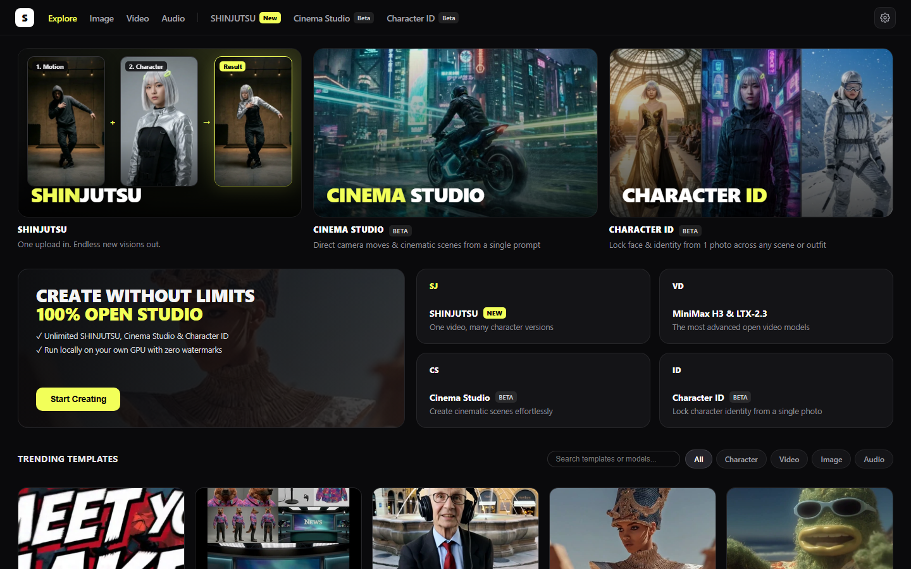
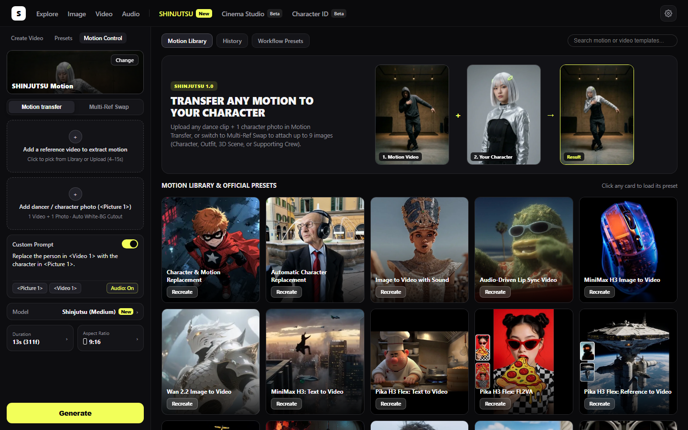
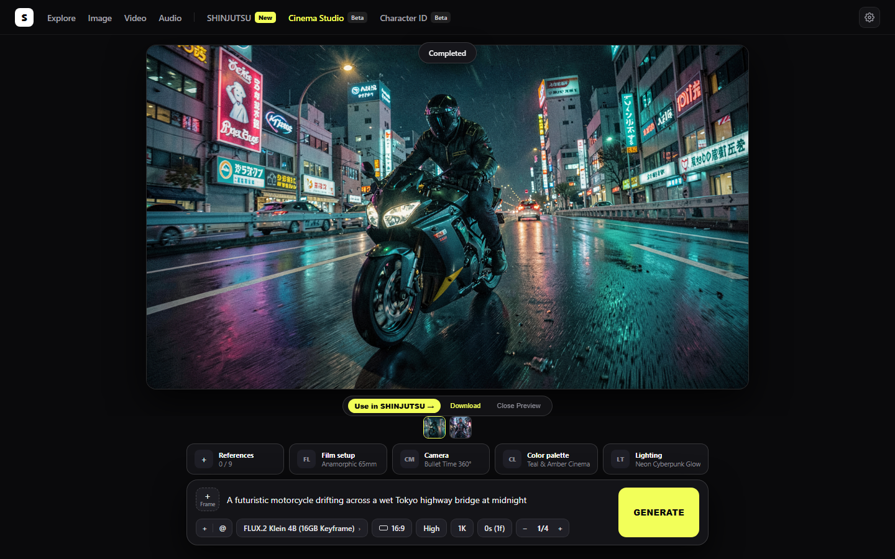
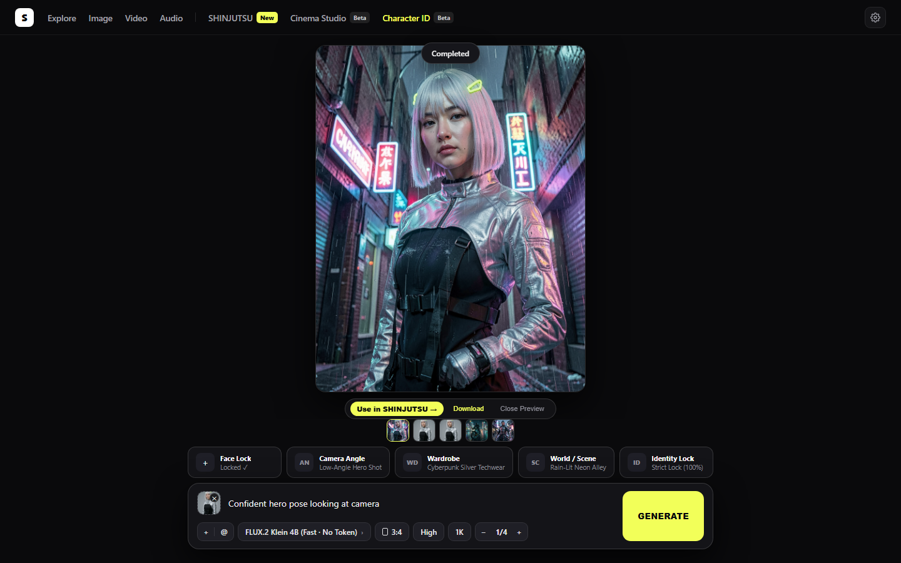

<div align="center">

English · <a href="https://shinjutsu.ai">Live Web Demo</a> · <a href="https://youtu.be/UJFlMayhyCE">2-Min Demo Video</a> · <a href="https://huggingface.co/makotolabs/SHINJUTSU-H3-Control-LoRA">Hugging Face Weights</a> · <a href="https://comfy.org/open-source-higgsfield">ComfyUI Challenge</a>

<h1>SHINJUTSU UI (神術): Open-Source AI Creative Studio for ComfyUI</h1>

<h3>One studio frontend and 33.3 MB motion-transfer engine across video, character lock, and audio on ComfyUI.</h3>

<p>Pick a camera lens, lock a character identity, or transfer full-body choreography — down to the 10-block SVD latent level, 100% locally.</p>

<p>
  
  <a href="https://huggingface.co/makotolabs/SHINJUTSU-H3-Control-LoRA"></a>
  
  <a href="https://github.com/makotolabs/SHINJUTSU-UI/actions/workflows/tests.yml"></a>
  <a href="LICENSE"></a>
</p>

<p>
  <a href="https://shinjutsu.ai"><b>Website (Live Demo)</b></a> · <a href="https://huggingface.co/makotolabs/SHINJUTSU-H3-Control-LoRA"><b>Model Weights</b></a> · <a href="#showcases"><b>Showcases</b></a>
</p>

<p>
  <a href="https://shinjutsu.ai">
    
  </a>
  <a href="https://youtu.be/UJFlMayhyCE">
    
  </a>
</p>

<p>
  <a href="#quick-start">Quick start</a> · <a href="#part-1-shinjutsu-ui--future-proof-studio-frontend-for-comfyui">How SHINJUTSU UI works</a> · <a href="#part-2-shinjutsu-motion-engine--333-mb-h3-control-lora">33.3 MB Motion Engine</a> · <a href="#showcases">Showcases</a> · <a href="#measured-end-to-end-performance">Benchmarks</a> · <a href="#project-structure">Project structure</a> · <a href="#models-and-licenses">Licenses & Provenance</a>
</p>

<p><code>git clone https://github.com/makotolabs/SHINJUTSU-UI.git</code></p>

</div>

> [!IMPORTANT]
> Get **SHINJUTSU UI** from [makotolabs/SHINJUTSU-UI](https://github.com/makotolabs/SHINJUTSU-UI), pull the open-weights **33.34 MiB SVD Control-LoRA** from **[makotolabs/SHINJUTSU-H3-Control-LoRA](https://huggingface.co/makotolabs/SHINJUTSU-H3-Control-LoRA)**, or preview the studio UI and showcase outputs at **[shinjutsu.ai](https://shinjutsu.ai)**. Built for the [ComfyUI Open-Source Higgsfield Challenge](https://comfy.org/open-source-higgsfield) — focused on **Open Weights Only** / **Most Innovative** (main category) and **Best Use of MiniMax H3** (model-provider bonus), with strict open-weights enforcement (`SHINJUTSU_OPEN_WEIGHTS_STRICT=1`) enabled by default.

---

## Showcases

<table>
<tr>
<td width="50%">
  
  <br><b>1. Explore Hub & Dynamic Template Sync.</b> Syncs official <code>Comfy-Org/workflow_templates</code> dynamically with one-click model downloads and zero node spaghetti.
</td>
<td width="50%">
  
  <br><b>2. SHINJUTSU Motion Transfer (MiniMax H3).</b> Transfers choreography from any driving video to a single character reference photo using a 33.34 MiB 10-block SVD Control-LoRA.
</td>
</tr>
<tr>
<td width="50%">
  
  <br><b>3. Cinema Studio & 5-Card Director Strip.</b> Interactive camera, lens, color grade, and lighting cards for <b>LTX-2.3 22B</b> audio-video and <b>FLUX 3 Image Klein</b> 16:9 keyframes.
</td>
<td width="50%">
  
  <br><b>4. Character ID Lock & 1-Click Handoff.</b> Locks facial identity via <code>ReferenceMultiLatent</code> on <b>FLUX 3 Image Klein</b> and sends the cutout character directly to <b>SHINJUTSU Motion</b> via <b><code>Use in SHINJUTSU →</code></b>.
</td>
</tr>
</table>

---

## Part 1: SHINJUTSU UI — Future-Proof Studio Frontend for ComfyUI

Most web wrappers hardcode static workflow JSONs that break whenever ComfyUI updates a node's inputs. **SHINJUTSU UI** (*神術*, literally *"Divine Technique"*—the tier beyond *Genjutsu* / *幻術*) treats your running ComfyUI instance as the single source of truth:

- **Zero-build, ultra-lightweight architecture (`< 3 MB` repo, zero `node_modules`).** Built with pure Vanilla HTML/CSS/JS on the frontend and standard Python on the backend—no Node.js toolchain, bundler build step, or external database required. Drop it into `ComfyUI/custom_nodes/` to mount `/shinjutsu` directly onto ComfyUI's server in 1 second, or run `python app_ui.py` standalone.
- **Forward-compatible template sync (`core/model_manager.py`).** Pulls the official `Comfy-Org/workflow_templates` catalog, flattens nested subgraphs (`definitions.subgraphs`), and compiles UI graphs into executable API prompts by reading widget order and types from your server's live `/object_info`. When ComfyUI ships new templates or updates node schemas, SHINJUTSU UI supports them automatically.
- **Pre-flight validation before queueing (`core/comfy_client.py`).** Every node class, required input, link target, socket type, and model filename is checked against `/object_info` before execution starts. Users get a clear message (*"missing model X"* or *"missing node Y"*) instead of a mid-render crash.
- **Dedicated open-weights studios with invisible Director Strip & 1-click handoff.** Tailored controls for **FLUX 3 Image Klein** (*Character ID (Beta)* one-photo identity lock via `ReferenceMultiLatent` + fast image generation), **LTX-2.3 22B** (*Cinema Studio (Beta)* two-pass audio-video generation), **MiniMax H3** (video & motion transfer), and **MiniMax Music 3** (full-song MP3 generation). Selecting camera, lens, lighting, wardrobe, or world cards on the 5-Card Director Strip compiles structured cinematography directives under the hood without cluttering the user's prompt, and every *Character ID* render auto-saves to the `Characters` library with a 1-click **`Use in SHINJUTSU →`** handoff.
- **Official Comfy SDK (API v2) + native fallback.** Routes jobs through `comfy-sdk` and `comfy-api-proxy` (or Comfy Cloud) when configured, and falls back to ComfyUI's native `POST /prompt` and `GET /history` with zero extra dependencies. Closed partner/API nodes are detected and blocked **by default** (`SHINJUTSU_OPEN_WEIGHTS_STRICT=1` out of the box).

```text
browser (/shinjutsu) ──► compiler (core/model_manager.py) ──► validator (core/comfy_client.py) ──► Comfy SDK / /prompt ──► ComfyUI
                         live template sync, subgraph         checks nodes, links, types           uploads assets &        core nodes +
                         flattening & /object_info mapping    & reconstructs 33 MB Control-LoRA    tracks job outputs      open weights
```

---

## Part 2: SHINJUTSU Motion Engine — 33.3 MB H3 Control-LoRA

Commercial cloud motion-transfer studios lock choreography and identity behind closed APIs, while standard open-weights pipelines require downloading a **12.92 GB** ControlNet (`MiniMax-H3-Fun-Controlnet-Union-2.0`) plus a **~3.1 GB** segmentation model (`SAM 3.1`). SHINJUTSU cuts that ~16 GB stack down to **118 MB**:

| Component | Standard Open Pipeline | SHINJUTSU Motion Engine | Why It Matters |
|---|---|---|---|
| **Motion Control Adapter** | Full `MiniMax-H3-Fun-Controlnet-Union-2.0` (**12.92 GB**) | [`shinjutsu_h3_control_lora_v1_flash.safetensors`](https://huggingface.co/makotolabs/SHINJUTSU-H3-Control-LoRA) (**33.34 MiB**) | **369.7× smaller download (99.73% reduction)**; reconstructs locally against your MiniMax H3 UNet in **2.4–3.0 s** on GPU |
| **Patch-Grid Cancellation** | Naive 2-block pruning (`[0, 5]`) leaves visible `32×32 px` tile grids | **All 10 injection blocks (`[0, 5..45]`) retained** (`Rank-64` bridges + `Rank-4` $\Delta W$) | Preserves full `2×2` latent patch-boundary cancellation in deeper layers with zero checkerboard artifacts |
| **Subject Reference Prep** | Unsegmented reference photo or ~3.1 GB `SAM 3.1` mask | **`BiRefNet_lite` (84.84 MiB, MIT)** auto-cutout onto neutral `(235, 235, 238)` canvas | **36× smaller**; isolates face, hair, and outfit so background clutter never pollutes reference tokens |
| **24 GB GPU Support** | Full BF16 / INT8 20-step pipeline requires 35+ GB VRAM | **Pruned W6A8 + 4-Step Turbo LoRA** (`core/control_lora_codec.py`) | Full 192-frame (8 s @ 24 fps) motion transfer runs in **19.55 GB peak VRAM** (`187.7 s`) |

---

## Measured End-to-End Performance

Every row below was verified end-to-end through `/shinjutsu/api/upload` → `/shinjutsu/api/queue` → `/shinjutsu/api/job-status` (`scripts/smoke_e2e.py`) on an NVIDIA RTX PRO 6000 Blackwell (96 GB) and an NVIDIA RTX 4060 Ti (16 GB) against ComfyUI (`1,021` nodes loaded):

| Studio Mode | Bundled Workflow | Open-Weights Stack | Output | Smoke Run | Full Render | Peak VRAM |
|---|---|---|---|---|---|---|
| **SHINJUTSU (Turbo)** | `01_shinjutsu_h3_motion_turbo_w6a8.json` | MiniMax H3 Ref2VA (Pruned W6A8) + 4-step Turbo LoRA + 33 MB Control-LoRA | 640×864, 24 fps | 31.3 s (22f) | 187.7 s (192f) | 19.6 GB |
| **SHINJUTSU (Medium)** | `01_shinjutsu_h3_motion_transfer.json` | MiniMax H3 Ref2VA (Pruned INT8) + 33 MB Control-LoRA | 640×864, 24 fps | 34.7 s (22f) | 389.9 s (192f) | 35.4 GB |
| **SHINJUTSU (High)** | `01_shinjutsu_h3_motion_high_unpruned.json` | MiniMax H3 Ref2VA (Unpruned INT8) + 33 MB Control-LoRA | 640×864, 24 fps | — | 401.6 s (192f) | ~48 GB |
| **Character ID (Beta)** | `03_soul_id_flux3_klein.json` | FLUX 3 Image Klein + Qwen3-VL 4B + FLUX 2 VAE (`ReferenceMultiLatent`) | 896×1152 PNG | 2.1–3.6 s | 36.2 s (1K) | ~13 GB |
| **Image Studio** | `03_soul_id_flux3_klein.json` | FLUX 3 Image Klein + Qwen3-VL 4B + FLUX 2 VAE | 1024×1024 PNG | 0.3 s (warm) | 16.6 s (1K) | ~13 GB |
| **Cinema Studio (Beta)** | `02_cinema_studio_ltx23_vfx.json` | LTX-2.3 22B FP8 + Distilled 1.1 LoRA + Gemma 3 12B FP4 + Upscaler ×2 | 512×512, 24 fps | 15.2 s (9f) | — | ~23 GB |
| **Audio Studio** | `05_audio_minimax_music3.json` | MiniMax Music 3 (DiT FP16 + INT8 text encoder + DAV audio VAE) | MP3 | 6.2 s | 102.1 s (30 s, 4060 Ti) | 14.4 GB |
| **Video (I2V)** | `04_video_minimax_h3_i2v.json` | MiniMax H3 FL2VA (Pruned INT8) + 8-step Turbo LoRA | — | Graph validated | Experimental | — |

---

## Quick Start

> [!TIP]
> **UI & Showcase Preview:** You can also browse the studio layout, 5-Card Director Strip, and pre-rendered **MiniMax H3** / **FLUX 3 Image Klein** showcase outputs in your browser at **[https://shinjutsu.ai](https://shinjutsu.ai)**.

### 1. Install as a ComfyUI custom node (recommended)

```bash
cd ComfyUI/custom_nodes
git clone https://github.com/makotolabs/SHINJUTSU-UI.git
pip install -r SHINJUTSU-UI/requirements.txt
```

Start ComfyUI and open **`http://127.0.0.1:8188/shinjutsu`** (or `<your-pod-url>/shinjutsu` on a remote GPU).

For **Character ID** and **Image** modes, accept the gated license at [black-forest-labs/flux-3-image-klein-comfy](https://huggingface.co/black-forest-labs/flux-3-image-klein-comfy) and set your Hugging Face token before downloading (or select the non-gated fast 4-step checkpoint in the Model Manager):

```bash
export HF_TOKEN=hf_...          # PowerShell: $env:HF_TOKEN="hf_..."
```

### 2. Other ways to run

- **1-click self-contained bootstrapper (no existing ComfyUI):** install PyTorch with CUDA, then run `python setup_and_run.py --install-comfy-reqs` (or `run_studio.bat` on Windows) to set up `./runtime/ComfyUI` and launch `/shinjutsu`.
- **Standalone server:** `python app_ui.py` serves the studio on `http://127.0.0.1:7865`.
- **Comfy SDK (API v2):** `pip install -r requirements-sdk.txt`, run `comfy-api-proxy --comfyui http://127.0.0.1:8188 --port 8189`, and set `COMFY_BASE_URL=http://127.0.0.1:8189`.

### 3. Tests

```bash
pip install -r requirements.txt aiohttp pytest
pytest -q                                                            # 53 passed against tests/fake_comfyui.py (no GPU needed)
python scripts/smoke_e2e.py --base-url http://127.0.0.1:8188         # live GPU end-to-end smoke runner
```

---

## Project Structure

Zero-build architecture (Vanilla HTML/CSS/JS frontend + pure Python backend):

```text
SHINJUTSU-UI/
├── __init__.py                  # ComfyUI custom_nodes entry point & /shinjutsu/* route mounting
├── app_ui.py                    # Standalone HTTP studio server & shared /api/* handlers
├── nodes.py                     # 3 native ComfyUI custom nodes (SHINJUTSU 神術 category)
├── shinjutsu.py                 # CLI runner for headless preprocessing & workflow compilation
├── setup_and_run.py             # Self-contained bootstrapper (clones ComfyUI & downloads weights)
├── core/
│   ├── model_manager.py         # Model registry, HF downloader, and UI-to-API graph compiler
│   ├── comfy_client.py          # Live /object_info pre-flight validator & ComfyUI queue client
│   ├── control_lora_codec.py    # 33.34 MiB SVD Control-LoRA reconstruction engine
│   ├── prep_engine.py           # BiRefNet_lite cutout & Depth Anything V2 control video prep
│   ├── prompt_compiler.py       # 6-Section MiniMax H3 positive-only prompt compiler
│   └── comfy_bridge.py          # Hardware profiles & temporal frame-grid snapping (6k+4)
├── web/
│   ├── index.html               # Single-page Studio UI shell
│   ├── css/shinjutsu.css        # Studio dark theme & responsive layout
│   └── js/
│       ├── models_and_compiler.js  # Mode catalog, model definitions & base state
│       └── app.js                  # Studio controller, Director Strip & ComfyUI graph builders
├── workflows/                   # 7 ready-to-import ComfyUI API workflow JSONs (100% core nodes)
└── tests/                       # 55 offline unit/integration tests + fake ComfyUI test harness
```

---

## Models and Licenses

SHINJUTSU UI code and the SVD compression codec (`core/control_lora_codec.py`) are released under the [MIT License](LICENSE). Model weights are downloaded from their official repositories under their upstream licenses:

| Model | Official Repository | Upstream License |
|---|---|---|
| SHINJUTSU H3 Control-LoRA (33.34 MiB) | [`makotolabs/SHINJUTSU-H3-Control-LoRA`](https://huggingface.co/makotolabs/SHINJUTSU-H3-Control-LoRA) | [MiniMax H3 Community License](https://huggingface.co/MiniMaxAI/MiniMax-H3/blob/main/LICENSE) (derived from `alibaba-pai/MiniMax-H3-Fun-Controlnet-Union-2.0` & `MiniMaxAI/MiniMax-H3`) |
| MiniMax H3 (Ref2VA, FL2VA, Qwen3-VL 32B, VAEs) | [`Comfy-Org/MiniMax-H3`](https://huggingface.co/Comfy-Org/MiniMax-H3) | [MiniMax H3 Community License](https://huggingface.co/MiniMaxAI/MiniMax-H3/blob/main/LICENSE) |
| MiniMax Music 3 | [`Comfy-Org/MiniMax-Music-3`](https://huggingface.co/Comfy-Org/MiniMax-Music-3) | MiniMax Community License |
| FLUX 3 Image Klein + Qwen3-VL 4B + FLUX 2 VAE | [`black-forest-labs/flux-3-image-klein-comfy`](https://huggingface.co/black-forest-labs/flux-3-image-klein-comfy) | Black Forest Labs FLUX 3 Klein License (gated) |
| LTX-2.3 22B Dev FP8 + Upscaler + Distilled LoRA | [`Lightricks/LTX-2.3-fp8`](https://huggingface.co/Lightricks/LTX-2.3-fp8) · [`Comfy-Org/ltx-2.3`](https://huggingface.co/Comfy-Org/ltx-2.3) | Lightricks LTX Open-Weights License |
| Gemma 3 12B IT FP4 | [`Comfy-Org/ltx-2.3`](https://huggingface.co/Comfy-Org/ltx-2.3) | Google Gemma Terms of Use |
| BiRefNet_lite (84.84 MiB) | [`ZhengPeng7/BiRefNet_lite`](https://huggingface.co/ZhengPeng7/BiRefNet_lite) | MIT License |

## Limitations and Media Provenance

- **Hardware:** Audio (14.4 GB) and FLUX 3 Image Klein (~13 GB) run on a 16 GB GPU. Full 192-frame MiniMax H3 motion transfer requires ~20 GB VRAM (W6A8 + Turbo LoRA) or ~36 GB VRAM (Pruned INT8, 20 steps), plus 4.12 GiB on disk in `ComfyUI/models/model_patches/` for the reconstructed patch.
- **Lossy SVD approximation:** The 33.34 MiB rank-64 / rank-4 archive approximates the 12.92 GB ControlNet (19.45 dB mean frame PSNR across 192 frames on seed `20272026`); pose and scene composition match closely while fine pixel details differ.
- **Media provenance:** All showcase characters and driving clips are synthetic AI-generated assets or consented team recordings; template thumbnails come from [`Comfy-Org/workflow_templates`](https://github.com/Comfy-Org/workflow_templates) (MIT). No unlicensed IP or unconsented real likenesses are used.
- **Disclaimer:** SHINJUTSU is an independent community project built for the ComfyUI Open-Source Higgsfield Challenge and is not affiliated with, endorsed by, or sponsored by Higgsfield AI.
